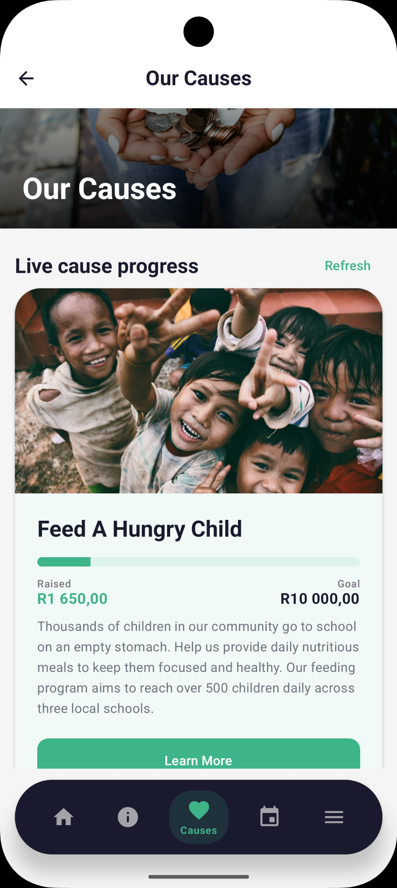
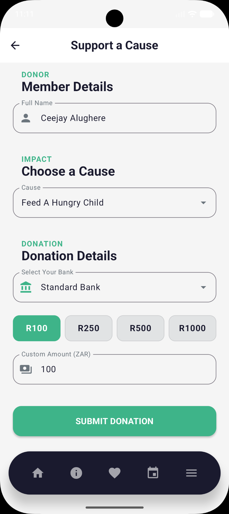
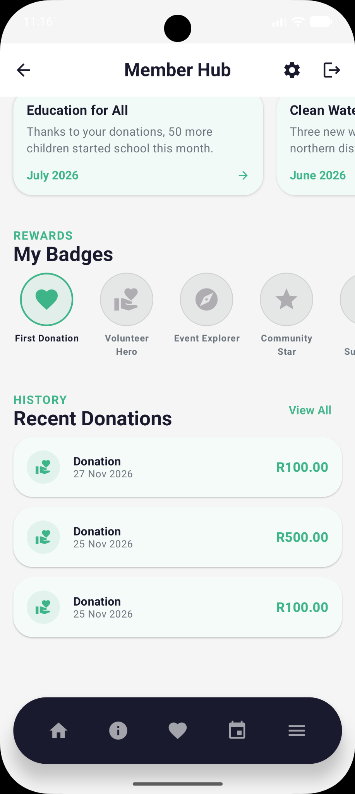
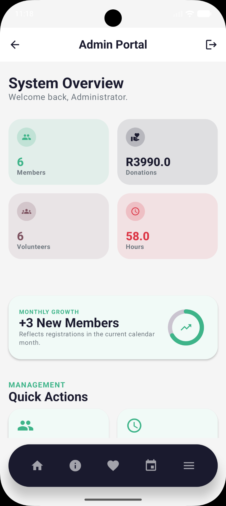

# Home of Hope

[](https://github.com/CeejayAlughere/HomeOfHopeApp/actions/workflows/android-ci.yml)

Members of **Home of Hope NGO (Siyazigabisa)** can use this Kotlin Android app to follow a fundraiser, record a contribution in South African rand and view their donation history. The Android app and the NGO’s website use the same PHP API and MySQL database, so staff can see which cause each contribution supports.

[Watch the project demonstration on YouTube](https://youtu.be/nTzSagurRYw)

## My contribution

I wrote the member screens in Kotlin with Jetpack Compose and connected them to the PHP and MySQL backend we shared with the website.

- **Member accounts.** I used Retrofit to connect registration and login to the website’s PHP API, so someone who registered on the website could sign in to the app with the same credentials. I used DataStore to save the member’s session on their device and added Google sign-in with Android Credential Manager and Firebase Authentication.

- **Fundraising and donations.** I built the screens where members can see how much each cause has raised towards its goal, choose a fundraiser, select their bank and enter an amount in rand. When a member taps **Submit Donation**, the app checks their entries and sends the donation under their account. Their donation history refreshes once the API confirms the record was saved.

- **Preventing duplicate donations.** I disabled the submit button while a donation was being saved and reused the original request ID if the member retried after a connection error. I checked that tapping twice quickly created just one record. Then I opened a fresh form and recorded another **R100** for the same cause. That second donation appeared separately with its own request ID.

- **Testing across the app and website.** I recorded a donation on my phone, opened the website’s admin dashboard and checked that the fundraiser and amount matched what I’d entered. I also set up GitHub Actions so pull requests to `main` build the debug APK, run the unit tests and run Android lint.

## The member experience

| Explore a fundraiser | Record a contribution | Check recent donations |
|:---:|:---:|:---:|
|  |  |  |

<details>
<summary>View the Android Admin Portal</summary>



Administrators can see membership growth, the total amount recorded in donations and the hours contributed by volunteers.

</details>

## Inside the donation flow

A member chooses a cause, selects a bank and amount, then taps **Submit Donation**. The app waits for the API to confirm the save before showing confirmation and refreshing the member’s history.

- [DonationScreen.kt](app/src/main/java/com/homeofhope/app/ui/screens/donation/DonationScreen.kt) collects the form details and assigns a request ID. If the connection drops, the member can retry with the same ID. Opening a fresh form creates a new ID.
- [DonationViewModel.kt](app/src/main/java/com/homeofhope/app/ui/viewmodel/DonationViewModel.kt) validates the form, blocks repeat taps while a submission is in progress and updates the screen when the request finishes.
- [DonationRepository.kt](app/src/main/java/com/homeofhope/app/data/repository/DonationRepository.kt) sends the authenticated donation request and retrieves the member’s history.

The screens use **Kotlin, Jetpack Compose and Material 3**. Repositories call the PHP API through **Retrofit and OkHttp**. The app uses **Room** for local data and **DataStore** for session information. Members can also sign in with Google through Android Credential Manager and Firebase Authentication.

## Build and test

The [Android CI workflow](.github/workflows/android-ci.yml) builds the debug APK, runs unit tests and checks Android lint on pull requests and pushes to `main`. Run the same checks from the repository root:

```bash
./gradlew :app:assembleDebug :app:testDebugUnitTest :app:lintDebug
```

The unit-test suite includes nine validation tests. We also tested two cases manually across Android and the website. Tapping **Submit Donation** twice in quick succession produced one record. Opening a fresh form and submitting another R100 to the same cause produced a second record with its own request ID.

## Run locally

```bash
git clone https://github.com/CeejayAlughere/HomeOfHopeApp.git
cd HomeOfHopeApp
```

1. Open the folder in Android Studio and sync Gradle. Install the SDK components the project requests. The CI build uses JDK 17.
2. Start the companion Home of Hope PHP/MySQL backend for live causes, member accounts and donations. Set the API base URL in [AuthRetrofitClient.kt](app/src/main/java/com/homeofhope/app/data/network/AuthRetrofitClient.kt) to an address your device can reach. On the standard Android emulator, use `10.0.2.2` to reach the development machine.
3. Select the `app` run configuration and launch it on an emulator or connected device. To use your own Firebase project for Google sign-in, configure Google authentication for the app’s application ID and signing certificate.

Our team used Azure Boards and Azure Repos during coursework. This GitHub repository hosts the Android source, pull requests and automated build checks.
